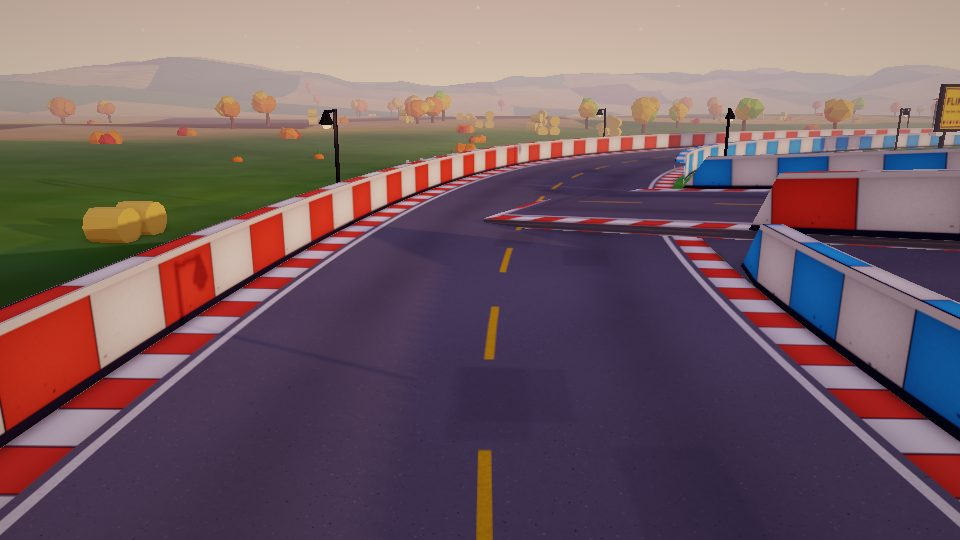
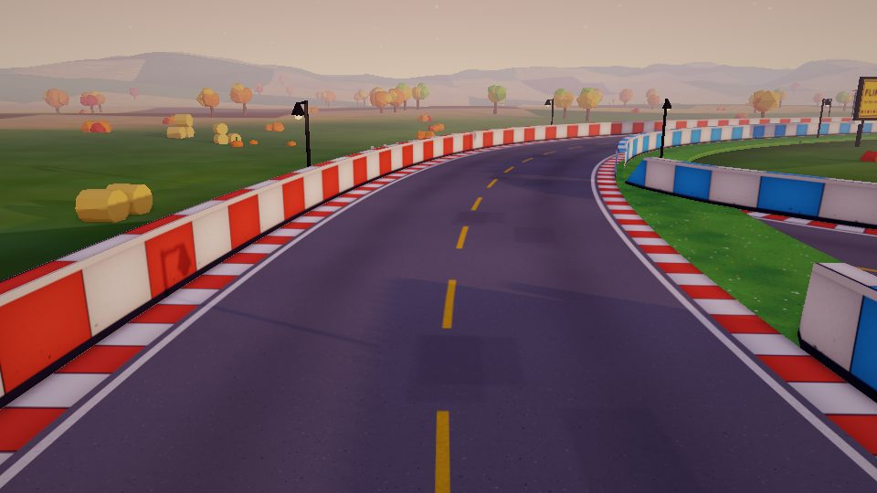
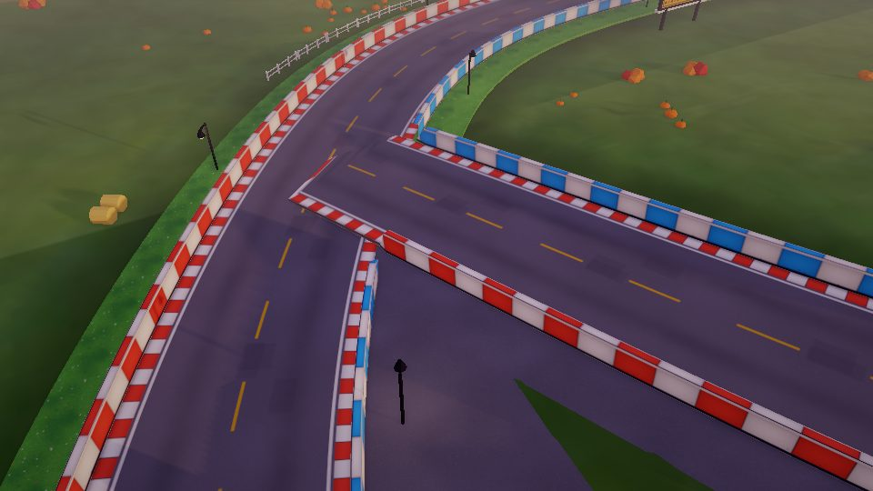
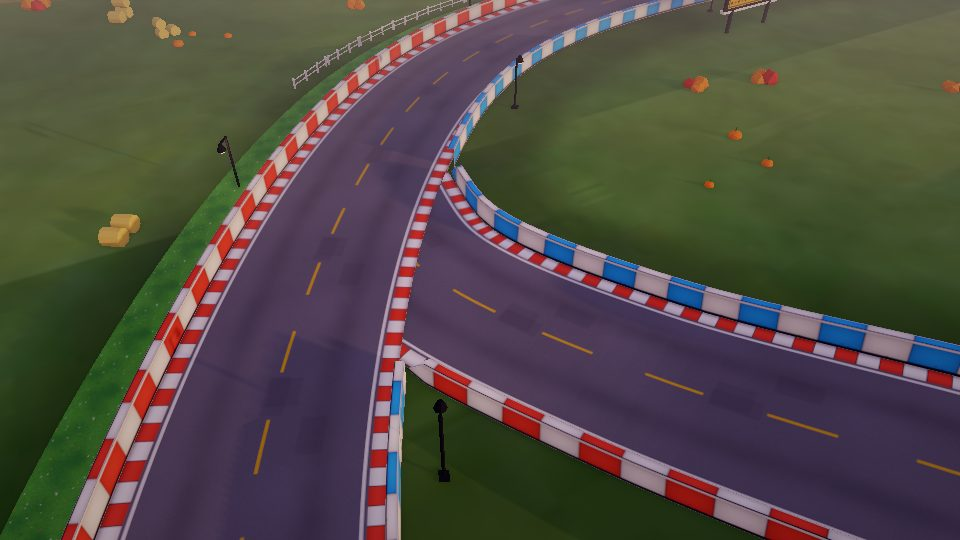
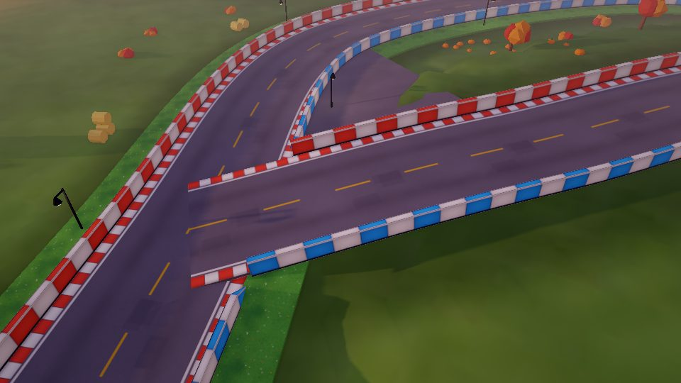
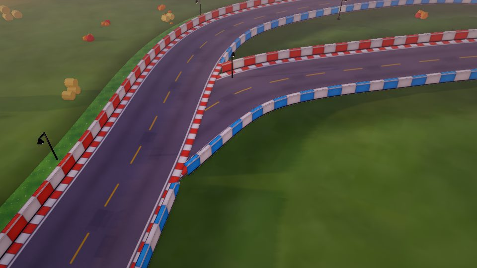
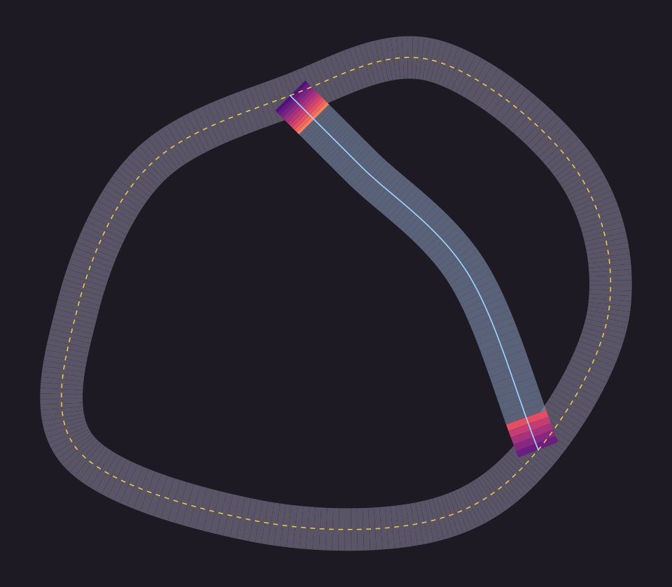
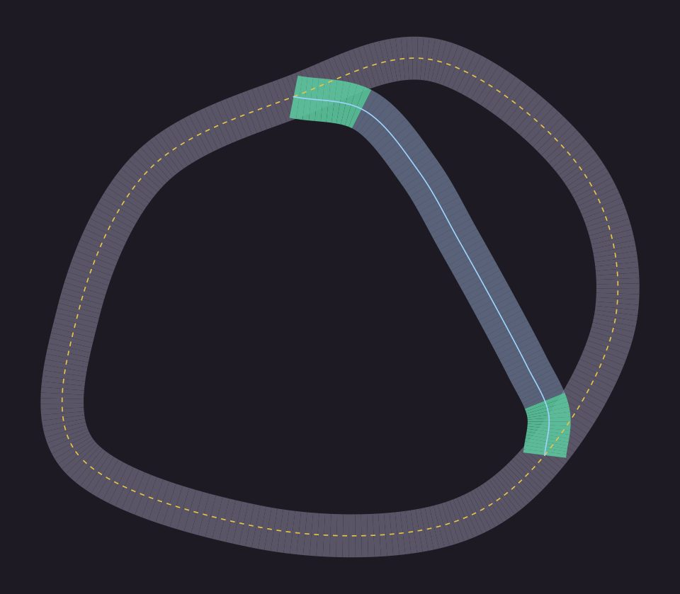

# Spike: the Crossroads shortcut over the main road (#35)

2026-10-30. Build ticket: #36.

## What the player sees

Coming down the back straight towards the merge, the shortcut's road crosses
the main road ahead: a plate of asphalt with its curb and its 0.3 m edge
showing, hovering at knee height and ending in the middle of the lane. It is
the merge in the request's screenshot. The fork has the same fault, less
visible from the driving line.

| Before | Prototype |
|---|---|
|  |  |
|  |  |
|  |  |

Renders: `flint render scenes/the_crossroads.scene.toml`, 960x540. Player view
at the merge `--target 140.5,1.2,-14.7 --yaw 153 --pitch 12 --distance 14`;
merge from above `--target 128,0,-14 --yaw 150 --pitch 40 --distance 40`; fork
from above `--target 70,0,-92 --yaw 300 --pitch 40 --distance 40`.

## Where and how much

`python tools/check_branch_overlap.py` samples both roads the way the engine
does and measures every stretch of shortcut surface that stands over the main
road. On master:

```
seg_branch_shortcut: 85 samples, 125.2 m
  meets the main road at 66 deg (fork), 61 deg (merge)
  over the main road at the fork: t 0.000-0.107, 8.7 m of branch, ~92 m^2 of slab
    branch top above main top: +0.00 to +1.03 m
    FAULT: 100% of it shows
  over the main road at the merge: t 0.940-1.000, 9.8 m of branch, ~52 m^2 of slab
    branch top above main top: +0.00 to +0.78 m
    FAULT: 100% of it shows
```

Only the fork and the merge. Mid-run the two roads never come within a road's
width of each other, so there is no crossing.

| Before | Prototype |
|---|---|
|  |  |

Plan view from `--plot`: hot colours show shortcut surface above the main
road (brighter is higher); green is shortcut surface tucked under it.

## Why

Three things the scene asks for that the engine never does:

1. **`skip_starts` / `skip_ends` are ignored.** `build_branching_track.py`
   writes `skip_starts = [0.0, 0.6667]`, `skip_ends = [0.3333, 1.0]` on
   `seg_branch_shortcut_road`, expecting the first and last span of the
   shortcut to go undrawn. Skip ranges were an engine feature of Trike's fork
   of Flint and were never ported to this engine (`grep skip_ engine/` finds
   nothing; `spline_gen.rs` `parse_spline_mesh_component` doesn't read them).
   So the whole spline is swept, from the fork point on the main road's centre
   line to the merge point on it. `generate_crossroads_walls.py` already knew
   this for walls ("skip_* asks for gaps the engine can't make") and cuts
   them in Python; the road itself was never handled.
2. **`context_start` / `context_end` are ignored.** The shortcut spline names
   the main road's neighbouring points so its ends would leave along the main
   road. The engine's `sample_open_spline` uses phantom end points instead
   (the first and last span reflected), so the end tangents point straight at
   the next control point: the shortcut leaves at 66 degrees and arrives at
   61, cutting across the main road rather than peeling off it.
3. **The climb starts at the junction.** `(60,0,-100)` to `(80,3,-80)` and
   `(110,4,-50)` to `(130,0,0)` rise and fall over the very spans that lie on
   the main road, so the part that overlaps is already up to 1.03 m (fork) and
   0.78 m (merge) above it.

The junction fills (`jfill_seg_branch_shortcut_fork` / `_merge`) were built
for the skipped spans: a fan from the main road's edge up to the shortcut's
edge at t = 1/3 and 2/3, which is 3 m up. With nothing skipped they sit inside
or under the slab and cover nothing.

### What physics does with it

The ground ray starts 0.5 m above the kart and the wall rays fire level at
0.5 m (`kart_controller.rhai`, ground ~line 101, walls ~line 703, anything
with `|normal_y| < 0.6` is a wall). Where the slab is less than 0.5 m proud the
kart pops up onto it; where it is 0.5 to 0.8 m proud (the 0.3 m edge spans the
ray height) its side is a wall standing across the main road's driving line.
The respawn and AI code find the nearest segment by distance to each spline
(`kart_controller.rhai` ~614, `ai_driver.rhai` ~296), so the shortcut spline
must keep starting and ending on the main road; only what is drawn should change.

## Options

| | Approach | Look | Physics | Effort |
|---|---|---|---|---|
| 1 | Move the shortcut's control points so the roads never overlap in plan | A gap at each junction that something else must fill: this becomes 3 | The spline no longer starts on the main road, so segment handover (AI, respawn) needs rework | Medium, and it doesn't finish the job |
| **2** | **Meet flush and tuck under: leave at ~30 degrees, hold the shortcut 6 cm under the main road until it is clear, then climb** | **The two slabs' union is the junction: a clean Y with one surface** | **One surface; a 6-17 cm step down onto the shortcut, which the ground snap absorbs. No slab edge at ray height** | **Low: recipe points, a tuck in the build tool, regenerate walls, cut the inner verge, drop the fills, re-dress** |
| 3 | Port skip ranges into the engine and rebuild the junction fill to taper and cap | Workable, but the fill and the road are separate meshes with seams and their own texture mapping | Two colliders meeting at a seam | High: an engine subtree change, a new fill generator, and the same climb problem as 2 |
| 4 | A true over/under crossing with supports | Nothing to cross: the roads only meet at fork and merge | n/a | A redesign of the track, not a fix |

## Recommendation: 2, flush and tucked

Prototyped in this spike (and reverted): the shortcut spline below, walls
regenerated, the fills and the inner verge removed, the dressing re-run.

```toml
# seg_branch_shortcut control points (y -0.06 = tucked under the main road)
[60, -0.06, -100]    # fork, on the main road's centre line
[80, -0.06,  -96]    # still on/under the main road, peeling off at ~30 deg
[95,  1.4,   -79]    # clear of it: climb
[106, 3.4,   -60]
[116, 2.6,   -42]
[125, -0.06, -25]    # down again before it reaches the main road
[131, -0.06, -12]
[130, -0.06,   0]    # merge, on the main road's centre line
```

The check passes ("ok: tucked under the main road, hidden" at both ends;
32 and 33 degrees). The shortcut becomes 132.0 m against the long way's 179.8 m,
so it still saves 47.8 m (54.6 m today); its highest control point is 3.4 m (4 m today).

What #36 needs beyond the points:

- **Build tool:** branch endpoints and the points that overlap the main road
  written at a tuck below it (`-0.06`), not at the main road's height. Stop
  emitting `skip_starts`/`skip_ends`, `context_*` and `cap_*`, which the
  engine ignores (the cause of this bug), and stop generating
  `jfill_*` (the union of the slabs is the fill).
- **Verges:** `track_verge_r` runs across the mouth at both junctions and its
  top (-0.03 m) sits above the tucked shortcut. Cut it where it stands on the
  shortcut, as `generate_crossroads_walls.py` cuts walls (the prototype just
  removed it).
- **Walls:** rerun `generate_crossroads_walls.py`. Its `abs(dy) > 2.0` test is
  not involved: the roads never cross mid-run and overlap only within 0.2 m of
  each other's height.
- **Dressing:** rerun `dress_track.py`; the terrain is carved to the shortcut
  spline, and the old carve buries the new path. A lamp lands in the merge's
  gore (`merge_high_after`); move it in the recipe.
- **Curb across the mouth:** the main road's painted curb still runs across
  each opening. It reads as an edge line; a curb-less texture span there is a
  polish item, not a blocker.
- **Drive it:** the -0.17 m dip near the fork is a Catmull-Rom undershoot
  between the tucked points and the climb; flatten if it is felt. Re-check AI
  `route_risk` choices, since the saving drops by 7 m.
